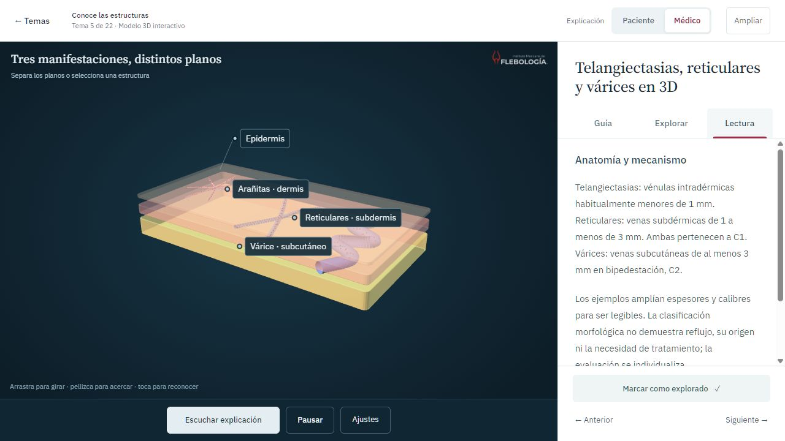
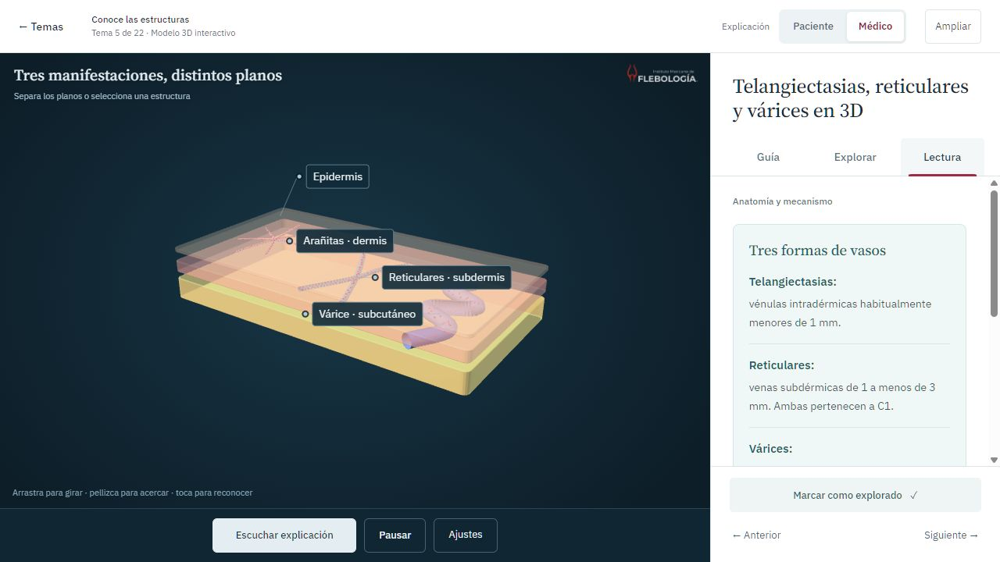
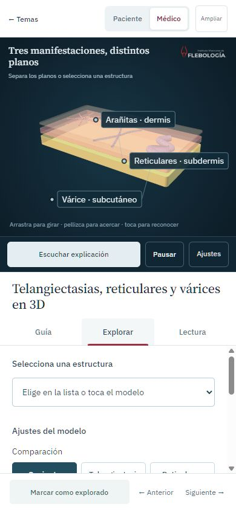
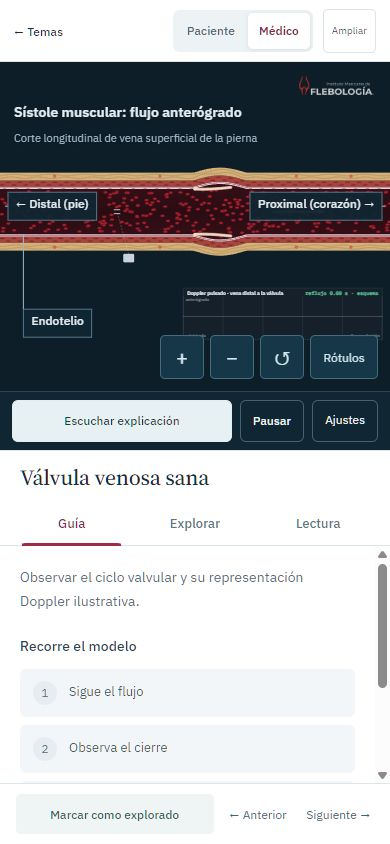
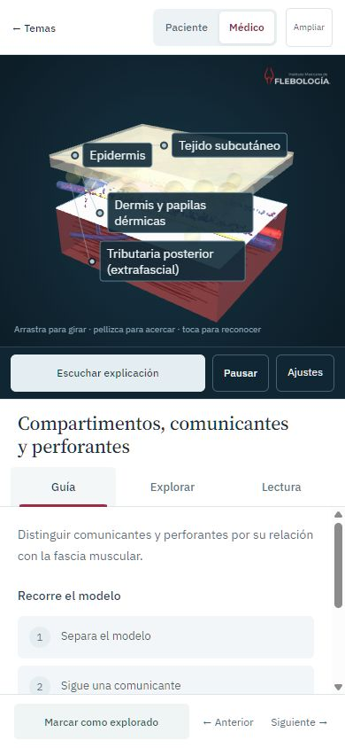
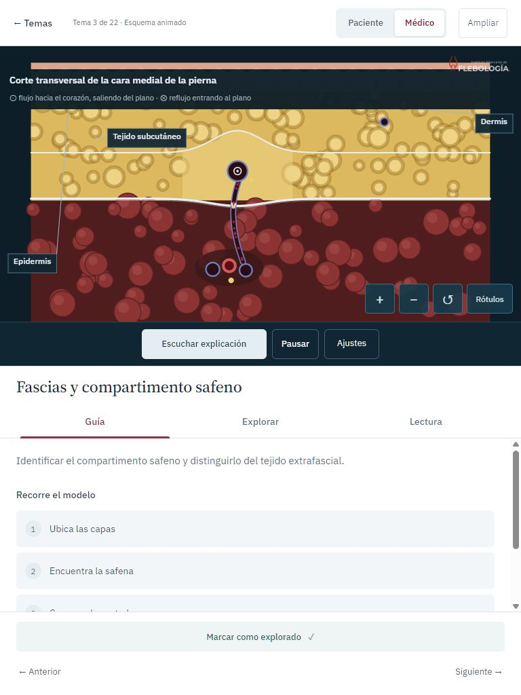

# Revisión integral de uso, animación y rendimiento

6 de noviembre de 2026. Catálogo: 22 temas, 13 modelos 3D, 9 esquemas 2D. Revisión sobre la versión posterior a `16b2803`, con correcciones implementadas en el código del proyecto.

## Resultado por recorrido

| Paso | Estado comprobado | Corrección o criterio |
| --- | --- | --- |
| 1. Entrar y elegir perfil | Correcto | Identidad IMF conservada; portada con pausa/reanudación explícita y preferencia de movimiento reducido al iniciar. |
| 2. Abrir y observar un tema | Correcto | Los 22 temas abren. La vista previa se libera antes de construir la escena. La carga prepara información del tema nuevo y desactiva acciones que requieren el modelo. |
| 3. Seguir la guía y explorar | Correcto | 66 pasos y 22 preguntas comprobados. Selección y aislamiento en los 13 modelos 3D. Ajustes principales visibles y secundarios en un desplegable. Las acciones de aislamiento aparecen al seleccionar una pieza. |
| 4. Leer y consultar fuentes | Correcto | Los dos perfiles conservan íntegros los párrafos originales. Cada párrafo tiene un título; CEAP y definiciones morfológicas tienen listas legibles. Fuentes separadas en su desplegable. |
| 5. Escuchar y navegar | Correcto en las pruebas descritas | Inicio de los 22 MP3 con subtítulos; dos narraciones completas; pestañas con teclado, Escape en ajustes y regreso a temas. |

## Hallazgos y correcciones

### Lectura: contenido denso sin puntos de entrada

La captura actual de Lectura mostraba dos párrafos largos, incluidas varias definiciones consecutivas. `assets/reading.js` añade títulos editoriales específicos para los 22 temas y agrupa el contenido sin reescribirlo. El primer bloque tiene un fondo suave y los siguientes un título y separación propia. Las categorías CEAP y los tres tipos morfológicos se presentan como listas.

Se comparó el texto visible de los cuerpos de lectura con el registro fuente para **44 combinaciones de tema/perfil**: coincide al normalizar espacios. Los títulos se comprueban además en `npm run check`. Las advertencias y los límites clínicos permanecen en la lectura; no se esconden automáticamente dentro de un acordeón.

Antes y después, mismo tema, perfil médico y viewport de 1280 × 720. La escena continúa animada; no corresponde al mismo instante:

### Explorar: controles sin selección y exceso de ajustes simultáneos

Se retiran de la vista las acciones de aislamiento mientras no hay una estructura seleccionada. Los dos primeros controles permanecen visibles; los restantes están en «Más ajustes del modelo». Restablecer el encuadre tiene una ubicación propia. Se trasladan los nodos originales, conservando callbacks, valores y acciones de narración; no se crean controles duplicados.

### Esquemas 2D: rótulos demasiado pequeños y controles sobre el dibujo

En pantallas estrechas, reducir un dibujo de 1000 × 600 también reducía sus letras a unos pocos píxeles. La nueva capa de anotaciones calcula posiciones en el dibujo y presenta hasta tres rótulos a tamaño de pantalla, con líneas de referencia y separación. «Rótulos» permite recorrer los demás. Sus nombres completos se conservan en la descripción accesible del canvas. El encabezado se presenta en HTML, con contraste estable.

Zoom, reducción, restauración y rótulos forman una fila. Las gráficas auxiliares siguen perteneciendo al dibujo y pueden requerir acercamiento y arrastre para leer sus detalles. No se presentan sus señales ilustrativas como mediciones clínicas.

### Encuadre y adaptación

El bloque de compartimentos quedaba recortado al abrirse en móvil. Su vista inicial, restauración y tres posiciones guiadas ajustan la distancia en una mesa estrecha. No se alteró su geometría ni sus relaciones anatómicas.

En una tableta vertical, una columna estrecha para el modelo dejaba demasiado espacio vacío. Entre 761 y 900 px en vertical, modelo y panel se apilan, aprovechando el ancho. La vista horizontal mantiene sus dos columnas.

### Carga y rendimiento

- La vista previa se destruye al comenzar a abrir un tema, antes de crear su contexto 3D.
- Durante la carga se actualizan título, objetivos, lectura y fuentes del tema solicitado. Reproducción y pasos esperan a que exista la escena. El fallo de carga conserva la explicación y ofrece reintento.
- Las dimensiones de rótulos y paneles 3D se actualizan con observadores de tamaño. Se eliminaron las consultas de tamaño intercaladas con escrituras de cada etiqueta en cada fotograma. Los observadores se desconectan al cerrar.
- Se conservan geometrías reutilizadas, partículas instanciadas, límite de resolución, carga diferida de 3D/audio, pausa al ocultar la pestaña y liberación de recursos. No se añadieron dependencias.
- La portada tiene un control explícito de pausa y arranca detenida si el sistema solicita movimiento reducido. El usuario puede reanudarla.

## Qué se midió

Navegador Chromium integrado en Codex, Windows. Escritorio 1280 × 800 y móvil emulado 390 × 844. Por tema se recogieron 120 fotogramas procesados, aproximadamente dos segundos después de abrir, sin limitar CPU o red. No se midieron tiempos GPU ni Core Web Vitals.

| Muestra de 22 temas | FPS mínimo–máximo entre temas | Mayor percentil 95 de intervalo | Trabajo medio de JS por fotograma |
| --- | --- | --- | --- |
| Referencia de escritorio | 58,8–60,4 | 18,2 ms | 1,24 ms |
| Escritorio con correcciones | 59,2–60,5 | 17,6 ms | 1,16 ms |
| Móvil emulado con correcciones | 59,2–60,3 | 23,5 ms | 1,29 ms |

Son muestras cortas en este equipo, no una garantía de 60 fps ni una comparación estadística. La reducción pequeña del promedio de CPU no debe atribuirse enteramente a una sola corrección. Los registros detallan cada tema y las condiciones.

El diagnóstico opcional `?rendimiento=1` escribe muestras en atributos del canvas; no envía datos ni guarda información de usuarios. El contador se reinicia al ocultar la pestaña para separar inactividad de trabajo visible. `data-open-ms` mide inicialización en JavaScript hasta preparar la escena; excluye la primera compilación/presentación GPU y no equivale a la carga inicial de la página.

## Comprobaciones funcionales

- 22 aperturas, 66 pasos, 22 respuestas correctas con retroalimentación y 13 selecciones/aislamientos.
- 44 lecturas comparadas con su fuente; fuentes presentes en cada tema. La revisión de interfaz no es una aprobación médica independiente.
- Los tres paneles de los 22 temas se abrieron a 390 × 844, sin desbordamiento horizontal. Se inspeccionaron las escenas y se inició cada narración con audio avanzando y subtítulo visible.
- Casos adicionales de fascias, compartimentos e ilíacas a 320 × 568, 740 × 390 y 768 × 1024. En los casos pequeños el panel conserva espacio de lectura y desplazamiento; la composición de tableta se volvió a comprobar después de apilarla.
- Narraciones completas: válvula sana, 49,789375 s y diez escenas; obstrucción ilíaca, 43,25875 s y siete escenas. No se repitieron completos los otros veinte MP3.
- Teclado: flecha derecha y Fin entre pestañas, Escape para cerrar ajustes. Pausa y reanudación de portada. Zoom y cambio de grupo de rótulos 2D.
- Movimiento reducido revisado en código, sin cambiar la preferencia del sistema. No se declara conformidad WCAG integral ni prueba con lector de pantalla o teléfono físico.

Registro: [revisión integral en JSON](animacion/entregas/revision-integral-2026-11-06.json). Capturas y datos corresponden a esta revisión, no a un informe histórico. Las capturas evidencian composición; la medición y la reproducción aportan comprobaciones distintas del movimiento.

## Mantener estas mejoras

Leer también [UX/UI del visor](UX_UI_VISOR.md), [MotionSites](DISENO_MOTIONSITES.md) y [la guía de producción](../GUIA_PARA_FUTURAS_ANIMACIONES.md).

Al añadir un tema: registrar sus títulos en `LESSON_READING`, conservar el texto clínico fuente, comprobar ambos perfiles y mantener intactas las acciones de guion. No volver a intercalar explicaciones entre parámetros. No sustituir rótulos pequeños por decenas de etiquetas simultáneas. Las gráficas y las fases deben poder consultarse con zoom, y el modelo debe volver al contexto.

Los criterios de foco, controles nativos, movimiento reducido, pausa y trabajo por fotograma se contrastaron con [Web Interface Guidelines de Vercel, consultadas en esta revisión](https://raw.githubusercontent.com/vercel-labs/web-interface-guidelines/main/command.md). Se aplicaron las guías locales de diseño, interacción y rendimiento compatibles con Three.js 0.128.0.
