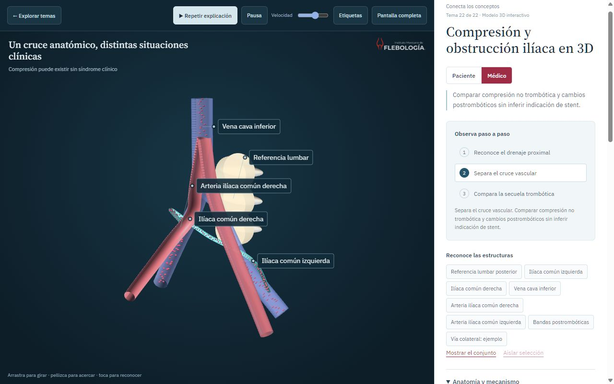
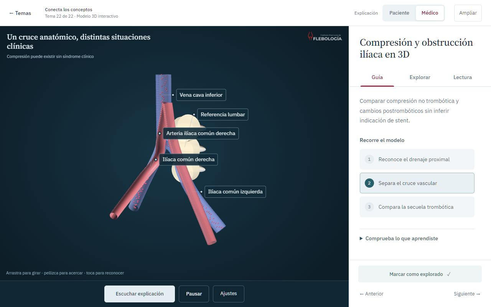

# Interfaz del visor: separación de tareas

6 de noviembre de 2026. Sustituye la composición del panel lateral descrita en los primeros apartados de `animacion/EXPERIENCIA_INTERACTIVA.md`.

## Problema observado

La captura de la versión publicada mostró una sola columna con título grande, perfil, objetivo, pasos, botones anatómicos, explicación, parámetros, fuentes, pregunta y navegación. El desplazamiento mezclaba lectura con manipulación. En móvil, parte de la barra de reproducción también saltaba de línea. La información existía, pero era difícil reconocer qué hacer primero.

El objetivo del cambio es observar el modelo, elegir una tarea y conservar el contexto al cambiar de nivel. La anatomía y las narraciones mantienen su contenido médico revisado.

## Composición

```
Temas | unidad y posición          Explicación: Paciente / Médico | Ampliar
┌─────────────────────────────────────────┬─────────────────────────┐
│                                         │ Título del tema        │
│              Modelo animado             │ Guía | Explorar | Lectura│
│                                         │ Una tarea a la vez     │
│                                         │ Área con scroll propio │
├─────────────────────────────────────────┼─────────────────────────┤
│ Escuchar explicación | Pausar | Ajustes  │ Exploración y navegación│
└─────────────────────────────────────────┴─────────────────────────┘
```

- **Guía:** un objetivo, tres pasos que cambian el modelo y una pregunta desplegable. No repetir el objetivo debajo de cada paso.
- **Explorar:** selector nativo de estructuras, aislamiento/restauración y parámetros del modelo. Los estados de lectura se agrupan en un desplegable independiente.
- **Lectura:** explicación por perfil, descripción de la estructura elegida y fuentes. Los párrafos no se intercalan entre sliders.
- **Reproducción:** siempre junto al modelo. Solo tres acciones principales. Velocidad y etiquetas dentro de «Ajustes»; la velocidad sigue disponible durante la narración.
- **Perfil:** ubicación fija en la cabecera. Cambia el lenguaje; no reinicia la cámara, el panel activo, el paso elegido o la respuesta de la pregunta.
- **Ampliar:** el modelo ocupa el espacio del panel. Solicita además pantalla completa si el navegador la admite; su utilidad no depende de esa autorización. «Reducir» o Escape restaura el panel.
- **Selección anatómica:** el modelo y un selector nativo comparten estado. El enlace «Leer sobre esta estructura» conduce a su descripción en Lectura. Un rótulo elegido en el modelo abre las herramientas sin robar el foco. La selección realizada por un paso mantiene Guía al finalizar.

En móvil se apilan cabecera, modelo con reproducción y panel de tareas. El título y las pestañas permanecen visibles; solo se desplaza el contenido del panel. Se conserva el avance entre temas, también en horizontal.

## Lenguaje visual

Se mantiene la identidad médica existente, con IBM Plex Sans para controles y lectura, y Source Serif 4 para el título. Base blanca `#ffffff`, mesa de observación `#0d1e28`, texto principal `#244756`, texto secundario `#536c78`, acento institucional `#9e2c45` y selección anatómica `#27606a`. Se elimina la sucesión de cajas y divisores decorativos; la separación indica cambios de tarea.

Los controles principales tienen un área de pulsación de unos 44 px. Los botones de pasos son filas legibles; las piezas no se presentan como un mosaico de chips. La columna mantiene un ancho estable al cambiar de pestaña, evitando redimensionar el canvas en cada cambio de contenido.

## Movimiento y acceso

Las pestañas usan botones con roles `tablist`, `tab` y `tabpanel`, `aria-selected`, `aria-controls` y foco itinerante. Flechas, Inicio y Fin cambian de pestaña; solo la seleccionada participa en el orden de tabulación. El foco del diálogo incluye selectores, desplegables nativos y paneles de lectura.

La entrada de un panel por pulsación usa opacidad y un desplazamiento de 4 px durante 180 ms, con `cubic-bezier(.23,1,.32,1)`. Cada nueva entrada cancela la anterior. El teclado cambia de vista inmediatamente; con movimiento reducido se omite esta entrada. No se animan ancho, altura o posición del canvas para decorar la navegación.

Escape cierra primero los ajustes de reproducción; después puede reducir el modelo o cerrar el tema. Los desplegables y el selector usan HTML nativo. Los subtítulos y el progreso se sitúan dentro de la mesa del modelo, por encima de la barra de reproducción.

## Fuentes y criterio

- [W3C, patrón de pestañas](https://www.w3.org/WAI/ARIA/apg/patterns/tabs/): semántica, foco y teclado.
- [Nielsen Norman Group, divulgación progresiva](https://www.nngroup.com/articles/progressive-disclosure/): separar funciones secundarias sin ocultar la tarea principal.
- [Vercel, guías de interfaz](https://github.com/vercel-labs/web-interface-guidelines/blob/434b7f91364665f2f733b310ec54809bf8f37937/command.md): foco visible, controles etiquetados, interrupción, movimiento reducido y contenido largo.
- [Guía instalada y procedencia](../skills/external/web-design-guidelines/PROVENANCE.md). Se aplicó junto con la guía de diseño frontal ya incorporada al proyecto y los criterios locales de animación.

No se importó una plantilla de aplicación ni se añadió un motor de interfaz ajeno a la web. El cambio usa el motor actual, HTML nativo, CSS y las escenas existentes.

## Archivos y reglas para futuras mejoras

- `index.html`: cabecera, tres vistas, transporte y contenedores semánticos.
- `assets/workspace.css`: composición vigente del visor; se carga al final y el build agrega su hash. Los estilos anteriores conservan componentes de portada y compatibilidad.
- `assets/experience.js`: pestañas, selección, perfiles, pasos, pregunta y separación de estados.
- `assets/app.js`: reproducción, amplitud del modelo, velocidad y foco del diálogo.

No volver a acumular todas las secciones en una sola columna. Un nuevo control debe tener una ubicación según su tarea: reproducción global, parámetros del modelo o lectura. No duplicar un control en varias vistas, ni cambiar sus nombres internos sin revisar las acciones de guion. Al mover una lectura de estado, conservar el nodo original para que sus callbacks sigan actualizándolo.

Probar los 22 temas, ambos perfiles, pasos, preguntas y selección/aislamiento. Comprobar narración en 2D y 3D, velocidad, pausa, subtítulos, reapertura, teclado, ampliación y tamaños estrechos. Registrar qué se comprobó realmente; una captura no demuestra fluidez ni conformidad integral con WCAG. Estas comprobaciones no sustituyen pruebas con usuarios o en teléfonos físicos.

## Revisión realizada

[Registro de comprobaciones y hashes](animacion/entregas/ux-ui-2026-11-06.json).

1. **Elegir nivel — correcto:** los dos perfiles funcionan en los 22 temas. El panel de Lectura permanece activo durante el cambio y el nivel del texto se actualiza.
2. **Seguir la guía — correcto:** se ejecutaron los 66 pasos y las 22 respuestas correctas muestran su retroalimentación. La pregunta se abre a petición.
3. **Explorar — correcto:** se seleccionó y aisló una pieza en cada uno de los 13 modelos 3D; se abrió su descripción. La limpieza de selección se comprobó también leyendo el valor del selector, la ficha oculta y el botón de aislamiento desactivado. No se repitió en esta entrega la selección individual de todas las piezas del catálogo.
4. **Leer — correcto:** texto visible en los 22 temas, separado de los controles. La descripción anatómica se consulta en esta vista. Fuentes conservadas por tema.
5. **Escuchar y controlar — correcto:** reproducción completa de obstrucción ilíaca (43,25875 s; siete escenas) y válvula sana (49,789375 s; diez escenas). Pausa y velocidad comprobadas sobre el audio; reproducción móvil parcial para comprobar subtítulos dentro de la escena y encima del transporte. No se reprodujeron completos los 22 audios otra vez.
6. **Navegar y ampliar — correcto:** flechas, Inicio, Fin, Tab y Shift+Tab; Escape cierra ajustes y restaura ampliación. El modelo pasa de 909 px a 1280 px de ancho en la prueba. Marcado de progreso y avance circular conservados.

Los 22 temas se abrieron con sus tres vistas a **390 × 844**, sin desbordamiento horizontal y con canvas presente. Comprobaciones adicionales del tema ilíaco a **320 × 568**, **740 × 390** y **768 × 1024**; navegación visible y contenido desplazable. Escritorio a **1280 × 800**. Cambiar de pestaña mantuvo la mesa del modelo en 909 × 663 px, sin redimensionamientos de contenido. En cambios rápidos quedó un solo panel visible y no hubo IDs duplicados ni errores/advertencias de consola. La muestra puntual del modelo fue de unos 60 fps; no es un benchmark.

`npm run check`, `npm run build` y revisión de formato pasaron. El movimiento reducido se revisó en código; no se modificó la preferencia del sistema. No se declara conformidad integral con WCAG, pruebas con usuarios ni prueba en teléfono físico.

### Comparación visual

Mismo tema, perfil médico y viewport de 1280 × 800. El modelo está animado; las capturas no corresponden al mismo instante de simulación.

Antes:



Después, Guía:



[Explorar](animacion/referencia/ux-ui/explorar-1280.png), [Lectura](animacion/referencia/ux-ui/lectura-1280.png), [móvil antes](animacion/referencia/ux-ui/antes-390.png) y [móvil después](animacion/referencia/ux-ui/guia-390.png).
