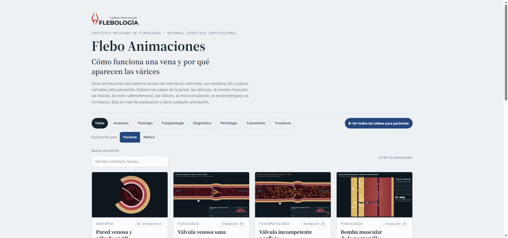
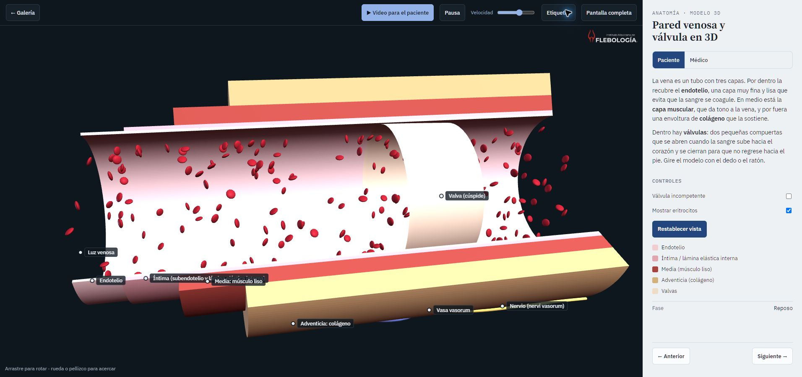
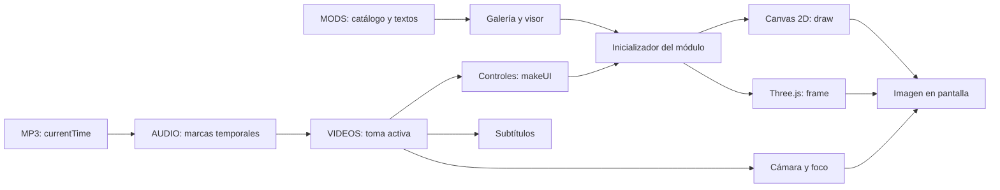

# Cómo están programadas las animaciones

Análisis del código de la referencia `2f643c9afdd8f1a21fae21cb2c4f32be233f243d`, publicado el 6 de noviembre de 2026. Los identificadores de funciones permiten localizar el código aunque cambien los números de línea.

**Lectura de la versión actual:** este documento conserva el análisis de origen. La evolución de la portada, recorrido y modelos se describe en [Experiencia interactiva](EXPERIENCIA_INTERACTIVA.md), incluidos selección, aislamiento, separación, reutilización de geometría y rótulos con colisiones.

Las capturas se conservan dentro del repositorio para que otro agente pueda reconocer la referencia sin depender de archivos locales privados. Muestran composición y detalle; no prueban el movimiento ni certifican la anatomía.

## Qué es el producto actual

Es una aplicación web estática en HTML, CSS y JavaScript, con **9 módulos Canvas 2D y 3 módulos Three.js 3D**. El catálogo contiene 124 tomas guiadas y 771,864 segundos de narración (aproximadamente 12 min 52 s), según sus registros de audio. No usa React, Blender, modelos GLB importados ni videos MP4 pregrabados. Los modelos se construyen mediante código. El modo «video» reproduce la misma simulación mientras un guion cambia cámara, controles y señales, con un MP3 y subtítulos sincronizados.

`assets/app.js` concentra la lógica. `assets/styles.css` contiene la interfaz adaptable y el visor; `index.html`, la estructura y metadatos. `audio/` tiene una narración por módulo. `assets/vendor/` conserva Three.js 0.128.0 y su OrbitControls, cargados al abrir el primer 3D. No hay solicitudes a servicios de IA al reproducir.

## Inventario de mecanismos y representación

| ID / inicializador | Motor | Estructura y movimiento programados |
| --- | --- | --- |
| `pared-3d` / `wall3D` | 3D | Pared abierta por capas, dos valvas deformables, vasos y nervio externos, 200 instancias de partículas; compara cierre y falta de coaptación. |
| `valvula-sana` / `valveSim(0)` | 2D | Corte longitudinal, capas dibujadas, cúspides con curvas Bézier, partículas, fases y trazado ilustrativo. |
| `valvula-incompetente` / `valveSim(0.85)` | 2D | Reutiliza el motor de válvula; un parámetro cambia diámetro, separación y flujo retrógrado. |
| `bomba-muscular` / `calfPump` | 2D | Corte de pierna, contracción/relajación, venas y perforante, desplazamiento de partículas y gráfica de presión ilustrativa. |
| `fascias` / `fasciaSim` | 2D | Corte transversal de piel, tejido subcutáneo, compartimento safeno y sistema profundo; cambios de estado. |
| `compartimentos-3d` / `compart3D` | 3D | Capas separables, vasos tubulares con curvas, conexiones y partículas instanciadas; énfasis selectivo por compartimento y tipo de vaso. |
| `union-safenofemoral` / `sfjSim` | 2D | Red de confluencia, válvulas, flujo, maniobra controlada y trazado ilustrativo. |
| `progresion-varice` / `tort3D` | 3D | Eje venoso curvo, radio variable, anillos valvulares, perforante, vena profunda y partículas; transformación progresiva parametrizada. |
| `microcirculacion` / `microSim` | 2D | Capilares/tejido, partículas e intercambio, cambios visuales y controles de parámetros ilustrativos. |
| `escleroterapia` / `scleroSim` | 2D | Secuencia por etapas: vaso, aguja, inyección, cambios en pared y cierre; burbujas, moléculas y capas de tejido. |
| `trombosis-venosa-profunda` / `dvtSim` | 2D | Seno valvular, partículas, crecimiento y desprendimiento ilustrativos, paneles relacionados y controles de escenario. |
| `sindrome-postrombotico` / `ptsSim` | 2D | Transformación del trombo y pared, canales/cicatriz, válvula alterada y esquema de pierna con lecturas. |

La tabla describe lo que dibuja el programa. No respalda la exactitud clínica de sus ecuaciones, umbrales o textos.

## Motor 2D

Cada inicializador recibe `{ctx}` y un constructor de controles `ui`; devuelve `{draw(dt, S)}`. `dt` está en segundos. `S` incluye reproducción, velocidad y visibilidad de etiquetas. El dibujo usa un espacio lógico de **1000 × 600** que `fit()` adapta al espacio disponible manteniendo la proporción. La resolución física se ajusta a la densidad de pantalla con límite de 2.

Los elementos se construyen con paths, curvas cuadráticas, elipses, bandas, gradientes, transparencias y texto. `lbl`, `banner`, `pill`, `arrow`, `rbc`, `drawValve`, `Trace` y `refluxMeter` son piezas reutilizables. Los estados viven en cierres de cada módulo: fase, tiempo, parámetros, partículas y paso de secuencia. Cambiar un control modifica el estado que determina la siguiente imagen.

La apariencia de mecanismo procede de coordinar **geometría + estado + desplazamiento + consecuencia visible**, no de animar una imagen terminada. Las gráficas reflejan funciones del modelo ilustrativo; no son mediciones de un paciente.

## Motor 3D

`make3D()` crea un `WebGLRenderer` con antialiasing, cámara de perspectiva de 38°, `OrbitControls` con amortiguación, luz hemisférica y dos luces direccionales. Un `ResizeObserver` ajusta el encuadre. Las etiquetas son elementos HTML que siguen un punto del modelo mediante proyección 3D → pantalla. Al cerrar se desconectan observadores y controles y se liberan geometrías, materiales y el contexto.

- **`wall3D`:** usa `Shape` + `ExtrudeGeometry` para superficies de la pared expuestas con longitudes distintas. Cada valva es una `BufferGeometry` cuyos vértices y normales cambian con el cierre. Los eritrocitos se aproximan mediante esferas achatadas, agrupadas en un `InstancedMesh`. Su desplazamiento depende de fase, posición radial y estado valvular.
- **`tort3D`:** calcula un eje con `CatmullRomCurve3`, genera un tubo y modifica radios a lo largo de su eje. Coloca anillos según tangentes locales. La tortuosidad, el diámetro y el flujo cambian con el parámetro de progresión. Reconstruye parte de la geometría al variar dicho parámetro. Usa 260 partículas superficiales y otras 70 profundas.
- **`compart3D`:** combina grupos de tejidos, superficies y vasos descritos mediante puntos, radios, tipo y compartimento. Usa `TubeGeometry` y bases locales tangente/normal/binormal para situar partículas dentro de vasos. Sus eritrocitos usan una `LatheGeometry` de perfil bicóncavo e instancias. La separación de capas y el énfasis se traducen en posiciones y opacidades.

El uso de instancias ya es una fortaleza. La mayor parte del movimiento continúa calculándose en CPU. No hay actualmente rig esquelético, importación glTF, simulación de fluido validada, detección general de colisiones ni resolución de solapamientos de etiquetas.

## Guion, audio y cámara

`MODS` relaciona ID, categoría, título, resumen, motor, inicializador, miniatura y dos niveles de texto. `VIDEOS[id]` es una lista ordenada de tomas. `AUDIO[id]` contiene duración y tiempos absolutos de comienzo de toma/frase en el MP3.

`vAudioTick()` consulta `audio.currentTime`, localiza la toma y actualiza subtítulo; `applyCue()` activa controles, puntos y objetivos de cámara. `vAct()` busca los controles **por su texto visible**. `vCam2D()` interpola centro/zoom; `vCam3D()` interpola posición y objetivo. Los focos y rótulos aíslan el elemento que explica la narración. Hay reproducción continua y respaldo por voz del navegador/subtítulos cuando falla el audio.

La temporización de audio es absoluta, pero la simulación, la cámara y algunas transiciones acumulan `dt`. Por ello la pieza actual no es totalmente reproducible al saltar directamente a un tiempo ni está preparada como renderizador independiente por fotogramas.

## Fortalezas y límites que importan para la siguiente versión

| Conservar | Superar |
| --- | --- |
| Capas, cortes y relaciones espaciales editables | Más continuidad de malla, mejor unión entre vasos y deformación de tejidos. |
| Válvulas/partículas vinculadas a estados | Trayectorias y transiciones más continuas, con control de penetraciones. |
| Guion con cámara, foco y subtítulo | Tiempo reproducible, acciones por ID estable y salto fiable a cualquier toma. |
| Instancias, carga diferida y limpieza | Reducir reconstrucciones de tubos y medir coste real en móvil. |
| Rótulos anclados al modelo | Resolver solapamientos, oclusión y selección por importancia. |
| Panel médico/paciente y exploración | Menos densidad visual por toma y composiciones específicas para móvil/video vertical. |

Las prioridades concretas y su aceptación se encuentran en [CALIDAD.md](CALIDAD.md). No se han implementado por el solo hecho de documentarlas.
