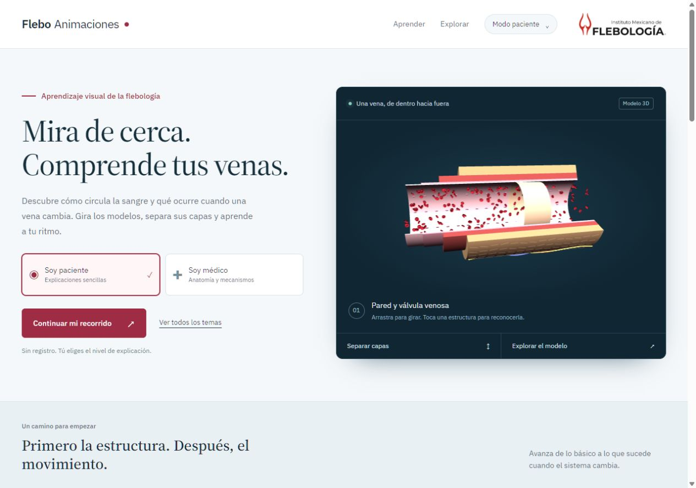
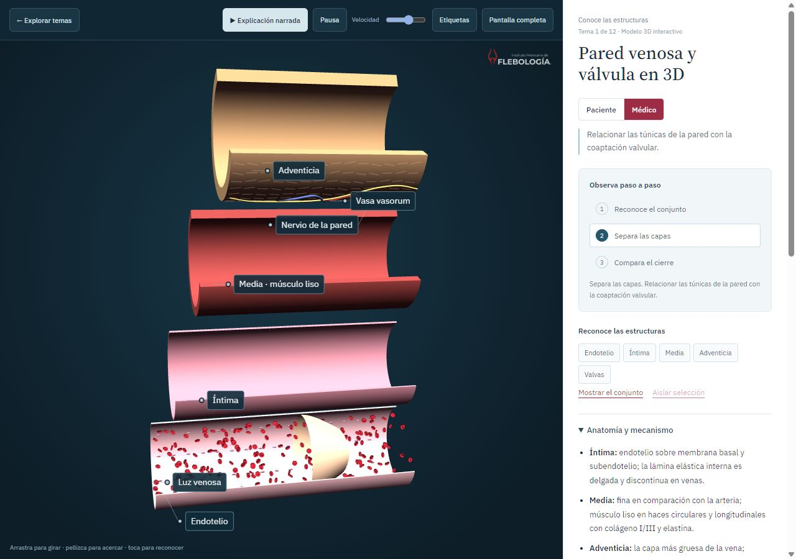

# Experiencia de aprendizaje y modelos interactivos

Implementación del 6 de noviembre de 2026, posterior al análisis de la referencia original. Leer junto con `ARQUITECTURA.md`: ese documento conserva el inventario y las limitaciones de la versión inicial; este describe los cambios realizados.

**Ampliación posterior del mismo día:** el catálogo tiene ahora 19 módulos, 57 pasos y 19 preguntas. Los siete modelos añadidos tienen 40 piezas seleccionables y narraciones nuevas con marcas de palabra del proveedor. Ver [producción y comprobaciones](entregas/siete-modulos-2026-11-06.md) y [revisión documental médica](REVISION_MEDICA_SIETE_MODULOS.md). Los apartados originales siguientes describen la primera evolución de doce módulos.

## Producto implementado

La portada presenta un modelo 3D real, dos niveles de explicación y un recorrido de cuatro unidades. Se mantienen los 12 módulos, sus narraciones y sus esquemas originales. El orden ahora comienza por la estructura, sigue por la función, muestra alteraciones y termina conectando conceptos clínicos.

- **Paciente:** títulos y objetivos sencillos, menos etiquetas y ajustes técnicos contraídos. Los controles de concentración, volumen y aguja de escleroterapia se ocultan en este perfil.
- **Médico:** nomenclatura, objetivos de mecanismo, más etiquetas y ajustes abiertos. El perfil se conserva al iniciar la explicación narrada; el audio original sigue siendo una narración para pacientes, no se ha generado una segunda versión médica.
- **Aprendizaje:** tres pasos que cambian estados o encuadres por módulo, una pregunta con retroalimentación y la acción voluntaria «Marcar como explorado». Visitar un tema no equivale a completarlo.
- **Navegación:** recorrido, biblioteca completa, filtro por unidad/categoría, búsqueda y avance entre temas en el orden didáctico.
- **Progreso:** se guarda exclusivamente en el navegador, sin cuenta ni servidor; no se sincroniza entre dispositivos ni certifica competencia clínica.

## Dónde ampliar la experiencia

| Archivo | Responsabilidad |
| --- | --- |
| `index.html` | Estructura semántica, portada, biblioteca, visor, selección de perfil y fuentes educativas. |
| `assets/course.js` | `COURSE.units`, `COURSE.lessons` y `COURSE.structures`: orden, objetivos por perfil, pasos/acciones, preguntas y fichas anatómicas. |
| `assets/app.js` | Modelos, esquemas, motor común 3D, controles, audio y cámara narrada. |
| `assets/experience.js` | Interfaz de aprendizaje, progreso, perfiles, pasos guiados y selección/aislamiento de piezas. |
| `assets/experience.css` | Diseño actual y composición adaptable; se carga después del estilo heredado. |

Para añadir un tema hay que integrarlo tanto en `MODS` como en `COURSE`: exactamente una unidad, tres pasos, dos objetivos, pregunta con respuesta correcta y explicación. Los pasos pueden accionar controles existentes mediante `vAct`; esta ruta todavía depende de sus textos. Si se cambia una etiqueta, actualizar los guiones y ejecutar la comprobación. La migración a acciones por ID estable sigue pendiente.

Los nombres de las estructuras deben ser estables y coincidir con `COURSE.structures`. La clave del texto sencillo es `patient`, aunque el valor del perfil público sea `paciente`. No confundir ambas convenciones.

## Motor anatómico compartido

Se conserva **Three.js r128**, cargado localmente y bajo demanda. Las nuevas capacidades se implementan con APIs compatibles:

- `make3D().register(mesh, id, name, manageOpacity)` vincula una o varias mallas a una pieza anatómica. Evitar registrar una misma malla bajo dos IDs diferentes.
- `selectPart(id)` permite reconocer una pieza desde la escena, una etiqueta o la lista accesible. El motor emite `flebo:part`; la interfaz muestra su ficha en el nivel de explicación activo.
- `isolatePart(true)` atenúa el contexto, prioriza el rótulo seleccionado y encuadra la pieza. `false` permite volver al contexto. Es una vista de aislamiento visual, no una segmentación médica del tejido.
- `moveCamera(position, target)` amortigua el cambio de encuadre. El usuario puede interrumpirlo al arrastrar. La cámara narrada mantiene su autoridad mientras reproduce el guion.
- `setExplode(value)` está disponible en pared y compartimentos. Separar capas es una transformación didáctica; no representa una deformación física real.
- `parts` expone las piezas seleccionables. Los módulos 2D conservan su contrato `draw`; reciben zoom, restauración del encuadre y arrastre cuando están ampliados.

El motor proyecta rótulos DOM con líneas de referencia y calcula sus colisiones en píxeles de pantalla. Se prioriza la selección, se limita el número simultáneo según perfil/ancho y se omiten los que no caben. Los rótulos 3D se muestran a 14 px. Esto resuelve solapamientos rectangulares; no implementa oclusión completa contra la profundidad de la malla. Las etiquetas internas de los esquemas 2D heredados aún pueden requerir acercamiento en móvil.

## Mejoras concretas del modelo y el movimiento

**Pared venosa:** cuatro superficies separables, selección de endotelio/íntima/media/adventicia/valvas, células endoteliales instanciadas, fibras externas y pequeños vasos/nervios ligados a la capa externa. La separación conserva cada detalle con su capa y deja espacio entre superficies. Los eritrocitos usan un perfil bicóncavo modelado por revolución.

**Várice:** se actualizan posiciones, normales y límites de los tubos existentes durante la transformación; no se sustituye una geometría completa en cada cambio. Mantiene las piezas de vena superficial, profunda, perforante, fascia y válvulas.

**Compartimentos:** tubos, anillos y valvas se reutilizan durante la separación. Las partículas siguen las trayectorias y sus marcos locales. Las piezas tienen semántica anatómica y aislamiento; el foco por grupo no debe atenuar la pieza que el usuario está aislando.

Estas mejoras no convierten las trayectorias ilustrativas en CFD ni crean un modelo anatómico derivado de imágenes de pacientes. No se han incorporado GLB, rig ni morph targets externos.

## Recursos, accesibilidad y rendimiento

La portada mantiene una sola vista previa activa y deja de animarla fuera de pantalla. Al abrir un módulo, destruye la vista previa y libera su contexto. Al cerrar, puede recrearla si vuelve a ser visible. El visor libera geometrías/materiales/controles y observadores al salir. Audio y bibliotecas 3D siguen siendo diferidos.

El build coloca hashes de contenido en las URLs de estilos y scripts, también en el HTML de la raíz que publica GitHub Pages. La comprobación pública detectó y corrigió una mezcla de HTML nuevo con JavaScript anterior guardado en caché. Siempre guardar el `index.html` generado junto con los cambios.

Se limita el DPR, el bucle se pausa al ocultar la pestaña y se respeta la preferencia de movimiento reducido. La pausa del mecanismo permite seguir usando la cámara manual. La narración conserva pausa y velocidad de audio; sus acciones automáticas no reemplazan la velocidad elegida por el usuario.

Hay foco visible, etiquetas seleccionables con teclado, lista alternativa de piezas, diálogo nativo de perfil y contenido exterior inerte al abrir el visor. En móvil, escena y explicación ocupan zonas separadas; el panel de lectura se desplaza por sí mismo.

## Comprobaciones realizadas y límites

Revisión del 6 de noviembre de 2026:

- `npm run check` valida sintaxis, recursos, 12 módulos, guiones/timestamps y cobertura de unidades, pasos, objetivos y preguntas.
- `npm run build` prepara la misma aplicación estática para GitHub Pages o Hostinger.
- En navegador se abrieron los 12 módulos; se probaron los 36 pasos, los dos perfiles, la retroalimentación de cada pregunta y el inicio de cada audio con subtítulos. No equivale a escuchar de principio a fin las 12 narraciones ni a una revisión médica integral.
- Se revisaron separación, selección y aislamiento en los tres módulos 3D; búsqueda, filtros, diálogo de perfil, pausa/velocidad y persistencia del progreso.
- Revisión adaptable en navegador Windows y viewport emulado de **390 × 844**. No se utilizó un teléfono físico. El contador del render mostró muestras de 60 fps en la vista dedicada; no se hizo un benchmark de percentiles ni una garantía para todos los dispositivos.

Quedan como mejoras futuras: auditoría clínica completa de textos/audios heredados, composición de rótulos 2D por tamaño, IDs de acciones, cronología determinista completa, bifurcaciones anatómicas más finas, activos GLB con procedencia y exportación MP4 comprobada cuando se solicite.

## Fuentes de contenido básico

Los nuevos objetivos y preguntas se mantienen cualitativos y se contrastaron con [NHLBI: varices](https://www.nhlbi.nih.gov/health/varicose-veins), [NHLBI: tromboembolismo venoso](https://www.nhlbi.nih.gov/health/venous-thromboembolism) y las [guías ESVS 2022 de enfermedad venosa crónica](https://esvs.org/wp-content/uploads/2023/03/ESVS-2022-CVD-Guidelines.pdf). Son fuentes de apoyo, no una aprobación del producto. Los números ilustrativos de las simulaciones no deben presentarse como pronósticos, prescripciones o estimaciones validadas.
